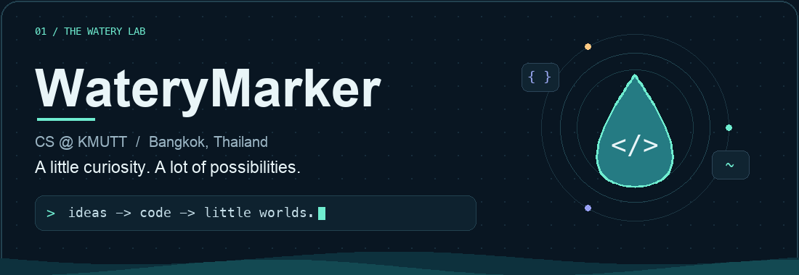

  

  
  &nbsp;
  

<b>สวัสดี 👋 I'm WateryMarker.</b> 
A computer science student at <b>KMUTT</b>, based in <b>Bangkok, Thailand</b>. 
From useful websites to playful AI apps and tiny simulated worlds.

### 01 / A few things I've built

<table>
<tr>
<td width="50%" valign="top">

#### 🌲 [Quiet Stream](https://github.com/WateryMarker/Fun-Env)

A living 3D forest: changing weather, growing plants, and autonomous wildlife in a native macOS world.

`C++` `SceneKit` `Metal`

</td>
<td width="50%" valign="top">

#### 🍔 [FAT-GPT](https://github.com/WateryMarker/fat-gpt)

A Thai AI chat app with Windows XP nostalgia, a hungry pixel character, and a kitchen minigame.

`Python` `Tkinter` `Ollama`

</td>
</tr>
<tr>
<td width="50%" valign="top">

#### 💸 [MindMyMoney](https://github.com/WateryMarker/mymindmoney)

Making loan concepts easier to explore with financial education and interactive repayment calculators.

`HTML` `CSS` `JavaScript` `PHP`

</td>
<td width="50%" valign="top">

#### 🗳️ [Vote System](https://github.com/WateryMarker/Vote-System)

A school popular-vote website — and the project where my Git journey began.

`Web` `School project` `First steps with Git`

</td>
</tr>
</table>

### 02 / My toolkit

| Area | Technologies |
| :--- | :--- |
| **Languages** | `C` `C++` `Java` `Python` `JavaScript` `PHP` `Swift` |
| **Web & data** | `HTML` `CSS` `MySQL` |
| **Development** | `Git` `Docker` `VS Code` `macOS` |
| **Creative & hardware** | `Blender` `Arduino` `Raspberry Pi` |

### 03 / Beyond the code

The projects here connect a few of my favorite things: practical tools, playful interfaces, and worlds that feel alive. This is my little corner to learn, experiment, and turn ideas into something you can use.

Have an idea to share? [Drop me a message](mailto:wapakpet28@gmail.com).

🌊 A still moment — view the banner without animation

 

 

  

